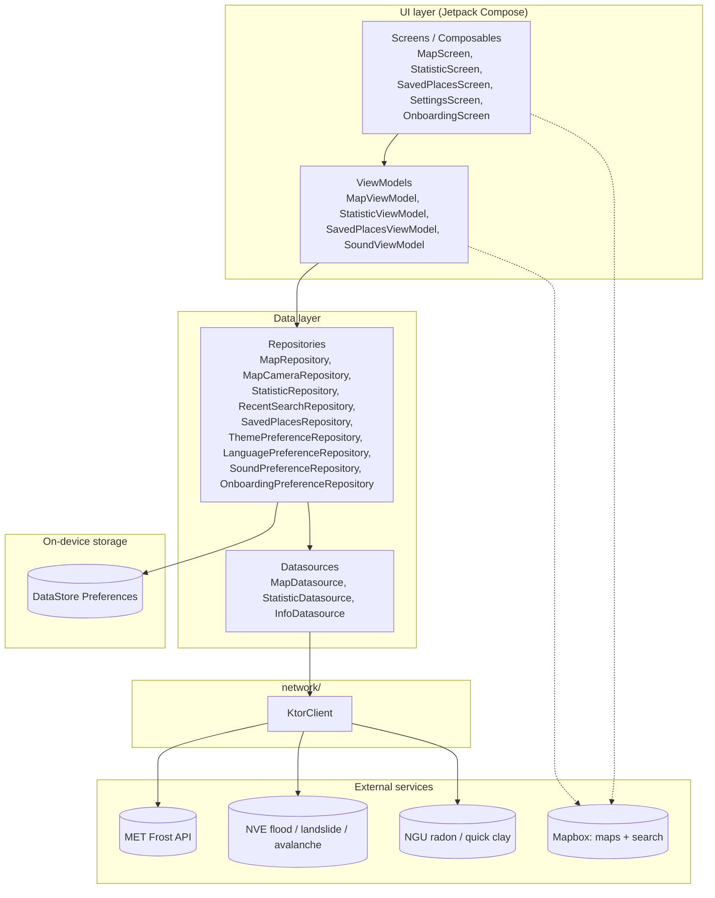

# Architecture - Team 45: Naturhendelser
This document describes the architecture of the Naturhendelser app, developed for case 3 in IN2000. It is intended for people who will work with the codebase, add features, or maintain it over time. It gives an overview of the project structure, the architectural decisions, and the patterns we follow.

The reader is assumed to be familiar with Kotlin and basic Android development. For the library list and how dependency injection is wired, see [README.md](README.md). For use cases, sequence diagrams and the class diagram, see [MODELING.md](MODELING.md). For git and commit rules, see [CONTRIBUTE.md](CONTRIBUTE.md).

## Technologies and dependencies
### Programming language and UI framework
The application is written in Kotlin, Google's recommended language for Android development. Kotlin provides more concise and safer code than Java through features such as null safety, extension functions, and first-class coroutine support.
The user interface is built using Jetpack Compose, Google's modern declarative UI framework. With Compose, the UI is defined through functions ("Composables") that automatically recompose when the underlying state changes. 

## Libraries
The full library list lives in `app/build.gradle.kts` and `gradle/libs.versions.toml`. README.md groups them by purpose (UI, navigation, networking, map, persistence, testing).

## Android API-level
We use `compileSdk` 36 and `targetSdk` 36 with `minSdk` 24 (Android 7.0, "Nougat").

`minSdk` 24 was picked because it gives us a modern Compose, Material 3 and coroutines stack without backports while still reaching the vast majority of phones in active use. Going lower would force a fragment-based UI. Going higher (26 or 30) would cut off older devices common in our user group (homeowners and cabin owners) without a clear gain.

`targetSdk` 36 matches the current Google Play submission requirement and gives us the newest platform defaults (predictive back, edge-to-edge, notification permissions, scoped storage). The app is tested on a Medium Phone emulator running Android 16.0 (API level 36.1, arm64).

## Layered structure
The application follows Google's recommended layered architecture with two main layers:
  - UI layer - handles everything the user sees and interacts with
  - Data layer - manages all data handling, fetching, and storage
    
Each layer has clearly defined responsibilities (Separation of Concerns) and communicates only downwards in the hierarchy. The UI layer depends on the data layer, but never the other way around.

### UI layer
The UI layer consists of two parts: Composable functions (UI elements) and ViewModels (state holders), which communicate through Unidirectional Data Flow (UDF).

Composables: 
All screens are implemented as Composable functions. A Composable is a stateless function that describes the UI based on the state it receives. When the state changes, Jetpack Compose automatically recomposes only the affected parts of the UI tree, resulting in efficient rendering.
Where possible, Composables are designed to be stateless. They receive data as parameters and propagate events upward through lambda functions, keeping a clear separation between UI and state management.

ViewModel and State: 
Each screen has a corresponding ViewModel that holds and manages UI-related state. The ViewModel survives configuration changes such as screen rotation, unlike Composables, ensuring that state is preserved during lifecycle events.

### Data layer
The data layer is responsible for fetching, storing, and providing data to the UI layer. It consists of two sublayers: datasources and repositories.

DataSource:
A datasource owns the wire format and the on-device storage details. For network calls, that means Ktor HTTP calls and JSON parsing (`MapDatasource`, `StatisticDatasource`, `InfoDatasource`). For local storage, that means DataStore Preferences keys and serializers (the per-feature preference repositories under `data/settings/`).

Repository:
A repository exposes the data layer's surface to the UI: suspend functions for one-shot calls and `Flow<T>` for anything reactive. Repositories own their datasources and combine them where needed (`MapRepository` wraps `MapDatasource` plus the hazard-zone checks; `SavedPlacesRepository` wraps a DataStore-backed list of places). A ViewModel only talks to repositories, never directly to a datasource.

Shared HTTP wiring lives in `network/KtorClient.kt`, so timeouts, serialization and the engine config exist in exactly one place.

## MVVM
The application implements the Model-View-ViewModel (MVVM) architecture, which is Google's recommended architectural pattern for Android development.
- Model: Repository, DataSource, and data classes
- View: The visual presentation layer, including Composable functions
- ViewModel: ViewModel classes using StateFlow and UI state management

## Dependency injection

We do not use Hilt or Dagger. Dependencies are wired manually:

- `MainActivity` creates the long-lived repositories
  (`ThemePreferenceRepository`, `LanguagePreferenceRepository`,
  `MapCameraRepository`, `SoundPreferenceRepository`, ...).
- Those repositories are passed to a `*ViewModelFactory`
  (`MapViewModelFactory`, `SoundViewModelFactory`) that constructs the
  matching ViewModel.
- `viewModel(factory = ...)` inside the Composable obtains the
  instance, scoped to the `NavBackStackEntry` or Activity.

ViewModels with no expensive dependencies use `AndroidViewModel` with
default constructor arguments. `StatisticViewModel` uses `@JvmOverloads`
so the default `AndroidViewModelFactory` finds the single-arg
`Application` constructor.

We picked manual DI because the dependency graph is small. Hilt would
add an annotation processor and Kapt config without payoff at this
scale.

## Object-oriented principles

### Low coupling
- The UI never imports from `network/` directly; it routes through a repository.
- Datasources never import UI.
- Each feature folder under `data/` mirrors a feature folder under `ui/`, so changes to climate logic don't touch the map code and vice versa.
- Cross-feature reuse happens through plain function calls. For example, `SavedPlacesViewModel` reuses `MapRepository` for hazard checks and `StatisticRepository` for nearest stations.

### High cohesion
- Files under `data/<feature>/` all deal with that feature's persistence and network calls.
- Helpers used by only one feature live next to it (`data/statistic/utils/StationPicker.kt`, `data/savedplaces/utils/NorwayLocationValidator.kt`).
- One Ktor client (`network/KtorClient.kt`) is shared so timeouts, serialization and the engine config exist in exactly one place.

### Single source of truth
The ViewModel is the only source of truth for screen state. The View never holds business state. State flows down (data layer to ViewModel to View) and events flow up (View to ViewModel), which is the unidirectional data flow described in the MVVM section.

For continuous data (DataStore-backed preferences, saved places list, last camera position), the source of truth is the `Flow<T>` exposed by the repository. The ViewModel turns it into a `StateFlow` via `stateIn` so the View observes a single hot stream.

## Project structure
```
ui/        screens, view-models, navigation, theme
  map/, statistic/, savedplaces/, settings/, info/, onboarding/, ...
data/      repositories, datasources, models
  map/, statistic/, savedplaces/, settings/, info/
network/   shared Ktor client (KtorClient.kt)
```

### Architecture sketch
The diagram shows the UI layer and data layer, the shared Ktor client, on-device storage, and the external services we depend on.



Read top to bottom: a composable touches its ViewModel; the ViewModel touches one or more repositories; repositories either call a datasource (remote, via Ktor) or DataStore (local). Mapbox is an SDK we drop into the UI for the map view, and into the ViewModel for the autocomplete client used in the search bar.

## Guidelines for further development
For git workflow, branch naming and commit rules, see [CONTRIBUTE.md](CONTRIBUTE.md).

- Don't add a domain layer just because. If logic that derives state grows large, factor it into helpers under `data/<feature>/utils/` first. Promote it to a separate layer only when there is real duplication.
- A new external API goes in a new `<feature>/Datasource` + `<feature>/Repository` pair. Don't call HTTP from a ViewModel.
- Persistence goes through DataStore via a `*PreferenceRepository`. Don't read or write SharedPreferences directly.
- The `StationPicker` logic in `data/statistic/utils` is the trickiest part of the app. Test changes against both Oslo (single Blindern station) and Stavanger (multi-station). See [README.md](README.md).
- Mapbox composables and plain Compose composables are different scopes. The IDE warnings listed in README.md describe the few places the two cross.
- DataStore writes must be on the IO dispatcher; all repository write helpers are already suspend functions, so call them from `viewModelScope.launch`.


