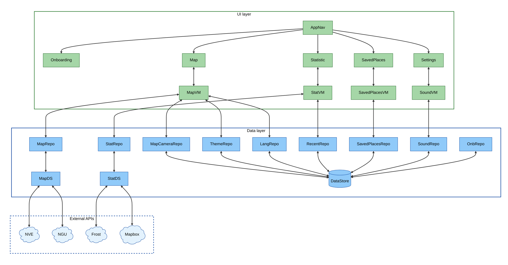

# Architecture - Team 45: Naturhendelser
This document describes the architecture of the Naturhendelser app, developed for case 3 in IN2000. It is intended for people who will maintain or further develop the app and need to understand the code style and practices we follow. It gives an overview of the project structure, the architectural decisions, and the patterns we use.

The reader is assumed to be familiar with Kotlin and basic Android development. For the library list, see [README.md](README.md). For use cases, sequence diagrams and the class diagram, see [MODELING.md](MODELING.md). For git and commit rules, see [CONTRIBUTE.md](CONTRIBUTE.md).

## Technologies and dependencies
### Programming language and UI framework
The application is written in Kotlin, Google's recommended language for Android development. Kotlin provides more concise and safer code than Java through features such as null safety, extension functions, and first-class coroutine support.
The user interface is built using Jetpack Compose, Google's modern declarative UI framework. With Compose, the UI is defined through functions ("Composables") that automatically recompose when the underlying state changes. 

## Libraries
The full library list lives in `app/build.gradle.kts` and `gradle/libs.versions.toml`. README.md groups them by purpose (UI, navigation, networking, map, persistence, testing).

## Android API-level
We use `compileSdk` 36 and `targetSdk` 36 with `minSdk` 24 (Android 7.0, "Nougat").

`minSdk` 24 was picked because it gives us a modern Compose, Material 3 and coroutines stack without backports while still reaching the vast majority of phones in active use. Going lower would force a fragment-based UI. Going higher (26 or 30) would cut off older devices common in our user group (homeowners and cabin owners) without a clear gain.

`targetSdk` 36 matches the current Google Play submission requirement and gives us the newest platform defaults (predictive back, edge-to-edge, notification permissions, scoped storage). The app is tested on a Medium Phone emulator running Android 16.0 (API level 36.1, arm64).

## Layered structure
The application follows Google's recommended layered architecture with two main layers:
  - UI layer - handles everything the user sees and interacts with
  - Data layer - manages all data handling, fetching, and storage
    
Each layer has clearly defined responsibilities (Separation of Concerns) and communicates only downwards in the hierarchy. The UI layer depends on the data layer, but never the other way around.

### UI layer
The UI layer consists of two parts: Composable functions (UI elements) and ViewModels (state holders), which communicate through Unidirectional Data Flow (UDF).

Composables: 
All screens are implemented as Composable functions. A Composable is a stateless function that describes the UI based on the state it receives. When the state changes, Jetpack Compose automatically recomposes only the affected parts of the UI tree, resulting in efficient rendering.
Where possible, Composables are designed to be stateless. They receive data as parameters and propagate events upward through lambda functions, keeping a clear separation between UI and state management.

ViewModel and State: 
Each screen has a corresponding ViewModel that holds and manages UI-related state. The ViewModel survives configuration changes such as screen rotation, unlike Composables, ensuring that state is preserved during lifecycle events.

### Data layer
The data layer is responsible for fetching, storing, and providing data to the UI layer. It consists of two sublayers: datasources and repositories.

DataSource:
A datasource owns the wire format and the on-device storage details. For network calls, that means Ktor HTTP calls and JSON parsing (`MapDatasource`, `StatisticDatasource`, `InfoDatasource`). For local storage, that means DataStore Preferences keys and serializers (the per-feature preference repositories under `data/settings/`).

Repository:
A repository exposes the data layer's surface to the UI: suspend functions for one-shot calls and `Flow<T>` for anything reactive. Repositories own their datasources and combine them where needed (`MapRepository` wraps `MapDatasource` plus the hazard-zone checks; `SavedPlacesRepository` wraps a DataStore-backed list of places). A ViewModel only talks to repositories, never directly to a datasource.

Shared HTTP wiring lives in `network/KtorClient.kt`, so timeouts, serialization and the engine config exist in exactly one place.

## MVVM
The application implements the Model-View-ViewModel (MVVM) architecture, which is Google's recommended architectural pattern for Android development.
- Model: Repository, DataSource, and data classes
- View: The visual presentation layer, including Composable functions
- ViewModel: ViewModel classes using StateFlow and UI state management

## Unidirectional Data Flow (UDF)
UDF is the data-flow pattern Compose and our ViewModels rely on. State flows in one direction, events in the other:

- State flows **down**: data layer to ViewModel to Composable. The ViewModel exposes state either as `StateFlow<UiState>` (via `stateIn` on a repository `Flow<T>`, used by `StatisticViewModel`, `SavedPlacesViewModel` and `SoundViewModel`) or as Compose `mutableStateOf` for screen-local state (`MapViewModel`). The Composable observes it; it does not mutate.
- Events flow **up**: the Composable calls a ViewModel method (or a lambda passed in by the parent) on user interaction.

This routes every state transition through one place (the ViewModel), which keeps recomposition cheap (only sub-trees that read the changed state recompose) and makes behavior reproducible. The "single source of truth" rule under "Object-oriented principles" is the same idea applied at the screen level.

## Activity Lifecycle and state preservation
Android destroys and re-creates Activities on certain events: screen rotation, switching dark/light theme at the OS level, or the OS reclaiming memory. The app combines three Android mechanisms so important information is not lost across those events.

**ViewModel scope (survives configuration changes).** Each screen has a `ViewModel` that outlives configuration changes. Anything held in a `StateFlow<UiState>` or Compose `mutableStateOf` on the VM is therefore preserved when the device rotates: the recomposed UI re-collects the state and renders identically. This is why search results in the Statistics screen, the active overlay on the Map screen and the saved-place list in Saved Places all survive a rotation without a reload.

**DataStore Preferences (survives process death).** When the app process itself is killed (the user swipes it away, or Android reclaims memory while the app is in the background) the ViewModel is destroyed too. Anything we need to keep across process death lives in DataStore Preferences behind a `*PreferenceRepository`:

- `MapCameraRepository` -- last camera position (zoom, lat/lon) so the map opens where the user left it
- `RecentSearchRepository` -- the recent place searches in the Statistics screen
- `SavedPlacesRepository` -- the user's saved places
- `ThemePreferenceRepository`, `LanguagePreferenceRepository`, `SoundPreferenceRepository` -- user-chosen settings
- `OnboardingPreferenceRepository` -- whether the user has completed the onboarding flow

Each VM collects the relevant `Flow<T>` from these repositories via `stateIn`, so on next launch the initial state is rehydrated before the user sees the screen.

**Navigation back-stack (survives in-app navigation).** When the user navigates to a different screen the previous `NavBackStackEntry` stays on the back-stack and its ViewModel stays alive. Returning to the screen shows it in the same state. `MainActivity` sets `android:configChanges="locale|layoutDirection"` in `AndroidManifest.xml` so that changing the in-app language doesn't tear down the activity -- the Compose tree just recomposes with the new strings.

Concretely, this covers every state-loss scenario in the produktkrav's robustness section:
- **Screen rotation**: ViewModel survives, state preserved.
- **User navigates between screens and back**: back-stack keeps the VM alive, state preserved.
- **App backgrounded then re-entered**: VM survives if the process is alive; if not, state is restored from DataStore on next launch (camera position, saved places, settings, recent searches).
- **Language change in Settings**: `configChanges="locale|layoutDirection"` keeps the activity, Compose recomposes with new strings.

## Dependency injection

We do not use Hilt or Dagger. Dependencies are wired manually:

- `MainActivity` creates the long-lived repositories
  (`ThemePreferenceRepository`, `LanguagePreferenceRepository`,
  `MapCameraRepository`, `SoundPreferenceRepository`, ...).
- Those repositories are passed to a `*ViewModelFactory`
  (`MapViewModelFactory`, `SoundViewModelFactory`) that constructs the
  matching ViewModel.
- `viewModel(factory = ...)` inside the Composable obtains the
  instance, scoped to the `NavBackStackEntry` or Activity.

ViewModels with no expensive dependencies use `AndroidViewModel` with
default constructor arguments. `StatisticViewModel` uses `@JvmOverloads`
so the default `AndroidViewModelFactory` finds the single-arg
`Application` constructor.

We picked manual DI because the dependency graph is small. Hilt would
add an annotation processor and Kapt config without payoff at this
scale.

## Network and API communication

All HTTP traffic goes through one shared Ktor client.
`network/KtorClient.kt` is an `object` that builds a single
`HttpClient` on the CIO engine with the `ContentNegotiation` plugin and
a lenient `kotlinx.serialization` JSON config (`ignoreUnknownKeys`,
`isLenient`). `StatisticDatasource` and `MapDatasource` import this
client instead of constructing their own, so the engine, timeouts and
JSON setup exist in one place.

### Frost authentication

`StatisticDatasource` calls the MET Frost API for stations, climate
normals and observations. Frost uses HTTP Basic auth. The datasource
builds the header in `authHeader()`: the Frost client ID is the
username, the password is empty, and the pair is Base64-encoded into an
`Authorization: Basic ...` header sent on every request. The Mapbox
geocoding endpoint, called from the same datasource, takes its access
token as a query parameter instead.

The app calls Frost directly rather than through the IFI proxy. Frost
is a public MET API with its own credentials, so routing through the
proxy would add a network hop without granting access the client ID
does not already provide. The Frost client ID and Mapbox token live in
`res/values/frost_client_id.xml` and
`res/values/mapbox_access_token.xml`, both kept out of version control.

### Asynchronous calls

Every datasource network function is a `suspend` function. The Ktor CIO
engine is coroutine-based and non-blocking: a `get()` call suspends the
coroutine rather than blocking the thread it runs on. ViewModels start
these calls inside `viewModelScope`, keep the resulting `Job`, and
cancel it when the user types a new query or leaves the screen (see
`searchJob` and `climateJob` in `StatisticViewModel`). One spot uses an
explicit dispatcher: `MapBitmapLoader.makeBitmap()` wraps overlay-image
decoding in `withContext(Dispatchers.IO)`, since bitmap decoding is
blocking work the Ktor engine does not handle. DataStore reads and
writes are suspend functions that the DataStore library runs off the
main thread.

## Error handling

Errors are handled at three levels: the datasource contains them, the
ViewModel turns them into state, and the UI renders that state.

### Datasource

Every network call in `StatisticDatasource` and `MapDatasource` runs
inside a `try`/`catch (e: Exception)`. On failure the datasource logs
the cause with `Log.e` and returns a safe empty value: an empty list,
an empty map, or `null`. A non-200 HTTP status is treated the same way.
A datasource never throws to its caller and never returns a partly
parsed result. This keeps a dropped connection or a malformed response
from crashing the app.

### ViewModel and UiState

The statistics screen models its state as a sealed interface,
`StatisticUiState`, with `Idle`, `Loading`, `StationResults`,
`PlaceResults`, `ClimateData` and `Error` cases. `StatisticViewModel`
wraps each repository call in a `try`/`catch`. On an exception it sets
`uiState` to `StatisticUiState.Error`, carrying a localized message
from a string resource (`error_search_failed`, `error_fetch_data` and
similar). An empty result that is not itself an exception (no station
found for the query) also maps to `Error`. `CancellationException` is
re-thrown rather than shown: a search the user has already replaced
should not paint an error.

### UI

`StatisticContent` is a `when` over `StatisticUiState`. The `Error`
case renders `ErrorContent`, a centered message in the Material 3
`error` color with a "Try again" button that returns the screen to its
idle search state. Connectivity has a separate path: `isOnline()` in
`NoInternetConnection.kt` registers a `ConnectivityManager` callback
and exposes the result as Compose state. `AppNavigation` reads it and
shows a "no internet connection" banner above the content while the
device is offline, so the user sees why a fetch failed instead of a
bare error message.

## Object-oriented principles

### Low coupling
- The UI never imports from `network/` directly; it routes through a repository.
- Datasources never import UI.
- Each feature folder under `data/` mirrors a feature folder under `ui/`, so changes to climate logic don't touch the map code and vice versa.
- Cross-feature reuse happens through plain function calls. For example, `SavedPlacesViewModel` reuses `MapRepository` for hazard checks and `StatisticRepository` for nearest stations.

### High cohesion
- Files under `data/<feature>/` all deal with that feature's persistence and network calls.
- Helpers used by only one feature live next to it (`data/statistic/utils/StationPicker.kt`, `data/savedplaces/utils/NorwayLocationValidator.kt`).
- One Ktor client (`network/KtorClient.kt`) is shared so timeouts, serialization and the engine config exist in exactly one place.

### Single source of truth
The ViewModel is the only source of truth for screen state. The View never holds business state. State flows down (data layer to ViewModel to View) and events flow up (View to ViewModel), as described in the UDF section above.

For continuous data (DataStore-backed preferences, saved places list, last camera position), the source of truth is the `Flow<T>` exposed by the repository. The ViewModel turns it into a `StateFlow` via `stateIn` so the View observes a single hot stream.

## Project structure
```
ui/        screens, view-models, navigation, theme
  map/, statistic/, savedplaces/, settings/, info/, onboarding/, ...
data/      repositories, datasources, models
  map/, statistic/, savedplaces/, settings/, info/
network/   shared Ktor client (KtorClient.kt)
```

### Architecture sketch
The diagram shows the UI layer and data layer, the shared Ktor client, on-device storage, and the external services we depend on.



**Label legend.** The diagram uses short labels so renderers don't truncate them. Full class names:

| In the diagram | Full class name |
|---|---|
| AppNav | `AppNavigation` |
| Onboarding / Map / Statistic / SavedPlaces / Settings | `OnboardingScreen` / `MapScreen` / `StatisticScreen` / `SavedPlacesScreen` / `SettingsScreen` |
| MapVM / StatVM / SavedPlacesVM / SoundVM | `MapViewModel` / `StatisticViewModel` / `SavedPlacesViewModel` / `SoundViewModel` |
| MapRepo / StatRepo / SavedPlacesRepo / MapCameraRepo / RecentRepo | `MapRepository` / `StatisticRepository` / `SavedPlacesRepository` / `MapCameraRepository` / `RecentSearchRepository` |
| ThemeRepo / LangRepo / SoundRepo / OnbRepo | `ThemePreferenceRepository` / `LanguagePreferenceRepository` / `SoundPreferenceRepository` / `OnboardingPreferenceRepository` |
| MapDS / StatDS | `MapDatasource` / `StatisticDatasource` |
| DataStore | `DataStore Preferences` (AndroidX) |
| Frost / NVE / NGU / Mapbox | MET Frost API / NVE Atlas / NGU services / Mapbox (maps + search) |

Read top to bottom. `AppNavigation` is the central nav host: from it the user reaches the three main screens (Map, Statistic, SavedPlaces), the Settings screen, and the Onboarding screen on first launch. Each screen owns its ViewModel; ViewModels then call one or more repositories. `MapViewModel` is the broadest: it reaches `MapRepository` for overlays and hazard checks, `MapCameraRepository` for the last camera position, and `ThemePreferenceRepository` + `LanguagePreferenceRepository` for user-chosen theme and language. Repositories either call a datasource that makes HTTP calls to an external API via the shared `KtorClient` under `network/`, or they read and write to `DataStore Preferences` directly. The four clouds inside the dashed "External APIs" group are services we don't host: NVE and NGU feed map overlays and hazard checks through `MapDatasource`; Frost (climate observations and normals) and Mapbox (geocoding, plus the in-SDK place-autocomplete client used in the search bar) feed `StatisticDatasource`. `OnboardingPreferenceRepository` is the one repository not owned by a ViewModel; `MainActivity` reads it directly to decide whether to show the Onboarding flow before the rest of the UI.

Two cross-feature dependencies are intentionally omitted from the diagram for readability and live here in prose instead: `SavedPlacesViewModel` calls `MapRepository` for hazard data per saved place, and `StatisticRepository` for the nearest weather stations.

## Guidelines for further development
For git workflow, branch naming and commit rules, see [CONTRIBUTE.md](CONTRIBUTE.md).

- Don't add a domain layer just because. If logic that derives state grows large, factor it into helpers under `data/<feature>/utils/` first. Promote it to a separate layer only when there is real duplication.
- A new external API goes in a new `<feature>/Datasource` + `<feature>/Repository` pair. Don't call HTTP from a ViewModel.
- Persistence goes through DataStore via a `*PreferenceRepository`. Don't read or write SharedPreferences directly.
- The `StationPicker` logic in `data/statistic/utils` is the trickiest part of the app. Test changes against both Oslo (single Blindern station) and Stavanger (multi-station). See [README.md](README.md).
- Mapbox composables and plain Compose composables are different scopes. The IDE warnings listed in README.md describe the few places the two cross.
- DataStore writes must be on the IO dispatcher; all repository write helpers are already suspend functions, so call them from `viewModelScope.launch`.

## Accessibility and adaptive layout

### Accessibility

The app targets WCAG 2.1 levels A and AA. The Compose tools used for it:

- **Content descriptions.** `Icon` and `Image` composables that carry
  meaning take a `contentDescription` from a string resource, so
  TalkBack can announce them. Purely decorative icons pass
  `contentDescription = null` so TalkBack skips them instead of reading
  noise.
- **Semantics modifier.** Where the describable element is not an
  `Icon` or `Image`, `Modifier.semantics { contentDescription = ... }`
  attaches the label directly (for example the buttons in
  `MapZoomControls`).
- **Material 3 color roles.** `Team45Theme` defines a full light and
  dark `colorScheme`. UI code reads `MaterialTheme.colorScheme` roles
  (`onSurface`, `error`, `surfaceContainer`) rather than fixed color
  values, so foreground and background pairs keep their intended
  contrast in both themes.
- **Scalable text.** Text sizes are declared in `sp`, so they follow
  the system font-scale setting. `UnscaledFont` is a deliberate
  exception: it pins the font scale to 1f in two cramped spots (the
  bottom navigation bar and the map zoom controls) where a very large
  system scale would otherwise break the layout.

### Adaptive layout

The app does not use `WindowSizeClass` or `BoxWithConstraints`. It is a
phone-only app and adapts to different phone sizes through Compose's
constraint-based layout rather than size breakpoints:

- `Modifier.fillMaxWidth()` and `Modifier.weight(...)` share the
  available width, so rows such as the bottom-bar items or the paired
  statistic cards split evenly at any phone width.
- `Modifier.height(IntrinsicSize.Min)` lets paired cards match the
  taller card's content height, so they stay aligned when text grows.
- Scrolling screens use `LazyColumn`, so content taller than the
  viewport scrolls instead of clipping.
- `Scaffold` and `WindowInsets` padding keep content clear of the
  status bar, the navigation bar and the app's own top and bottom bars.
- Spacing and sizing use `dp`, so they scale with screen density.

## Code documentation

A majority of the code including functions, classes, and enums is well documented using Kotlin KDoc-style docstrings. These docstrings are fully written and typically include all the relevant tags such as @param, @return, and other annotations that clearly describe inputs, output, and behavior. For some of the complex parts of the code, additional comments are used to explain the behavior.

Some of this documentation can feel slightly redundant at times for example, when @param tags mainly repeat information that is already clear from the function signature or the name. However, this consistency is still valuable because it creates a predictable structure across the code, improves readability in larger teams, and helps tools like IDEs to present and explain a complete view of the code. Overall, even when some details may seem repetitive, the clarity and long term maintainability benefits outweigh the extra redundancy.
