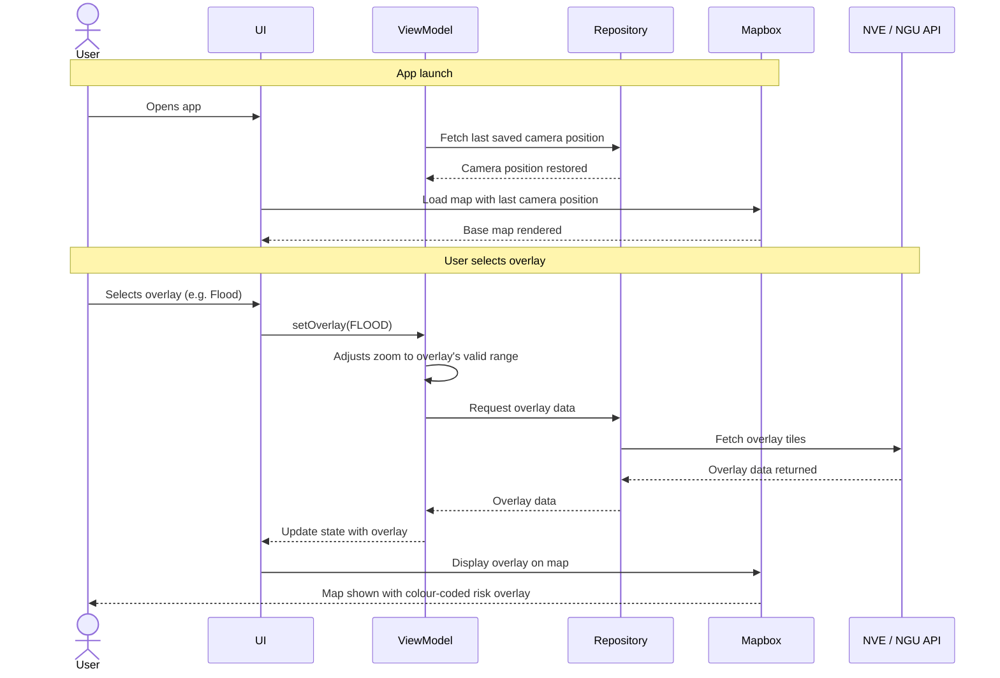
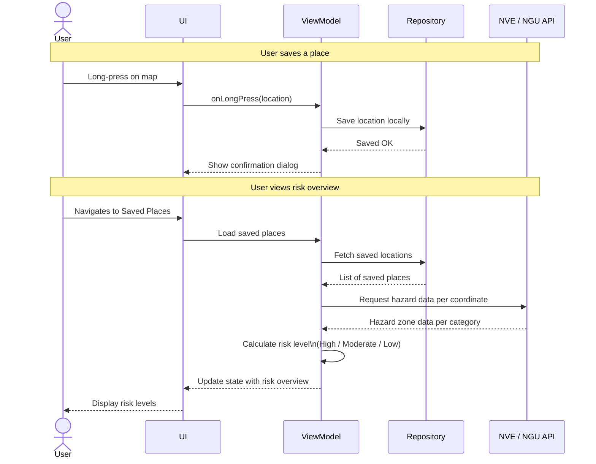

## 2. Textual Description of the Most Important Use Cases

### UC1 – Show Map with Overlay
 
| Field | Content |
|---|---|
| **System** | Climate Risk App – (map functionallity) |
| **Primary actor** | User (home or cabin owner) |
| **Secondary actor** | External map provider (Mapbox), external hazard data provider (NVE/NGU)|
| **Goal** | View natural hazards for a geographic area visualised as colour-coded map overlays |
| **Stakeholders** | User wants clear and understandable risk visualization. NVE/NGU want correct representation of their data|
| **Preconditions** | App is installed and open; device has network access |
| **Trigger** | User opens the app or selects a map overlay from the overlay menu |
| **Basic flow** | 1. User opens the app. 2. Map loads with the last used overlay. 3. User selects a map overlay (e.g. flood). 4. Zoom level is adjusted to the overlay's valid range . 5. Overlay tiles are fetched from NVE/NGU and rendered on the map. 6. User reads the colour-code legend to interpret risk levels. |
| **Alternate flow 1** | API unavailable → error message is shown; map is displayed without the overlay. |
| **Alternate flow 2** | User switches to a different overlay → zoom is re-adjusted and new tiles are fetched. |
| **Alternate flow 3** | User deactivates the overlay → map returns to base layer with no risk data shown. |

---

### UC3 / UC4 – Save Place and Risk Overview
 
| Field | Content |
|---|---|
| **System** | Climate Risk App – MapScreen and SavedPlacesScreen |
| **Primary actor** | User (home or cabin owner) |
| **Secondary actor** | External map provider (Mapbox), external hazard data provider (NVE/NGU) |
| **Goal** | Save a property to a personal list and view a combined climate risk overview with recommended measures |
| **Stakeholders** | User wants a persistent, personalised risk overview for their own properties |
| **Preconditions** | App is open on MapScreen; device has network access |
| **Trigger** | User long-presses a point on the map |
| **Basic flow** | 1. User long-presses a location on the map. 2. A popup appears and. 3. The location is saved locally with coordinates. 4. User navigates to SavedPlacesScreen. 5. System loads saved places. 6. Risk data is fetched from NVE/NGU per coordinate and displayed with colour coding and a textual risk level. 7. Recommended measures and relevant external resources are presented based on the identified risk level. |
| **Alternate flow 1** | No network access -> last known risk data is shown from cache |
| **Alternate flow 2** | User optionally searches for an address first (UC2 extends UC3) before long-pressing to save the exact location. |
| **Alternate flow 3** | User deletes a saved place -> it is removed from local storage and disappears from SavedPlacesScreen. |
 
---

### UC6 – Explore Historical Climate Statistics
 
| Field | Content |
|---|---|
| **System** | Climate Risk App – StatisticScreen |
| **Primary actor** | User (home or cabin owner) |
| **Secondary actor** | External climate data provider (MET Frost) |
| **Goal** | Explore aggregated historical climate data for a chosen place, presented as graphs over time |
| **Stakeholders** | User wants to understand long-term climate trends for a location |
| **Preconditions** | App is open and device has network access |
| **Trigger** | User searches for a place |
| **Basic flow** | 1. User opens the statistics feature. 2. System displays a search field and recent searches. 3. User enters a place name and submits the search. 4. System saves the search in recent search history. 5. System shows a loading indicator. 6. System requests historical climate data from the external data provider. 7. System receives aggregated data (e.g. temperature, precipitation, wind, snow depth). 8. System displays the data as graphs over time.|
| **Alternate flow 1** | Search field is empty -> system does not perform a search and keeps the input active. |
| **Alternate flow 2** | Incomplete data is returned for the query -> system shows an error message and shows what it got. |
| **Alternate flow 3** | User resets the view → system clears displayed data but retains the search history and returns to the initial state|
 
---

## 3. Sequence Diagrams

### 3.1 Show Map with Overlay (UC1)
 
**Choice and rationale:** Shows the asynchronous flow between the user, UI layer, ViewModel, Repository (including local storage) and external APIs when selecting a map overlay. Illustrates how the MVVM pattern handles network calls and state updates, and how zoom is constrained per overlay type.
 

 
---

### 3.2 Save Place and View Risk Overview (UC3 / UC4)
 
**Choice and rationale:** Shows the long-press flow from user interaction to local storage and retrieval of risk data, including interaction between the Saved Places feature and external hazard data APIs. UC5 has a `«include»` relation to UC4, but is not taken into account here to simplify the diagram.
 

 
---