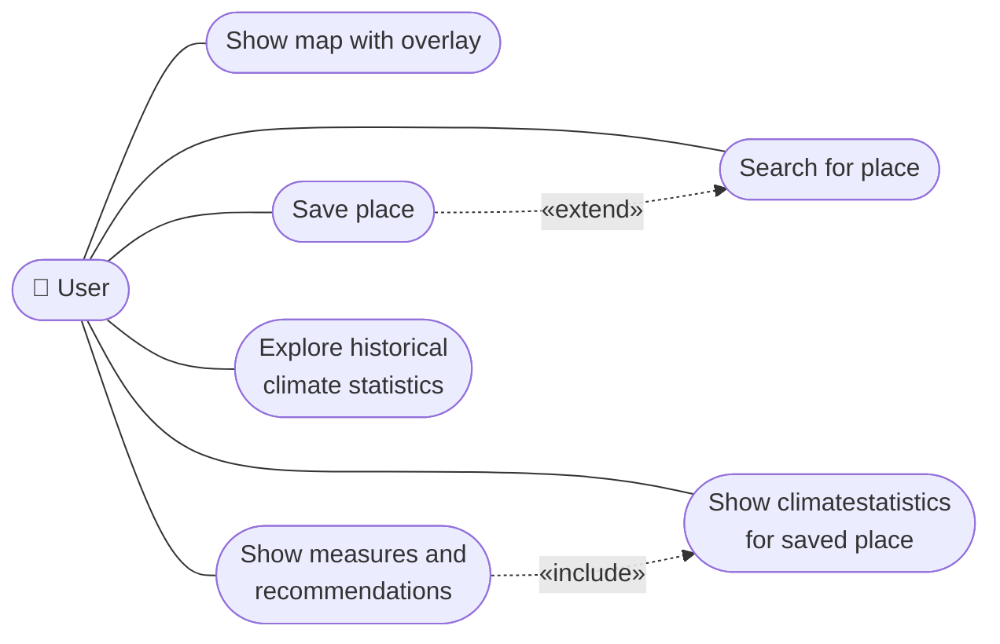

## 1. Use Case Diagram
 
**Choice and rationale:** The use case diagram provides a high-level overview of the functions the system offers and the actors involved. The six use cases shown represent the core functional requirements of the app. `«include»` is used where one use case *always* requires another, and `«extend»` where a use case is optional or conditional.

**`«extend»` explained:**
- `Save place` extends `Search for place` — the user can optionally search for a place before saving it, but may also long-press directly on the map.

**`«include»` explained:**
- `Show measures and recommendations` always requires `Show climate statistics for saved place` — relevant recommendations are always derived from the identified risk level and cannot be shown without it.